# Remote hand installation guide

This guide walks you through installing Remote hand step by step. It takes about 10 minutes. Steps are written for macOS. To have a coding agent install it for you, send it the [agent install manual](install-agent.en.md). 中文版：[install-guide.md](install-guide.md)。

> The screenshots show the English Paseo UI, except the npm error and the direct connection screenshots, which show the Chinese UI.

## What Remote hand does

Say you write code on computer A but want to use the models on computer B, for example an always-on Mac mini signed in to Claude and Codex subscriptions. With Remote hand installed:

- In Paseo on A, you create an agent and pick a model such as "B · Codex · GPT-…".
- The conversation runs on B, using B's subscription.
- Reading files, editing files, and running commands all happen in A's project.

This guide uses two names:

| Name | Which machine | Example |
|---|---|---|
| **brain** | The machine that provides the models | An always-on Mac mini |
| **hand** | The machine with your projects, where you work | Your laptop |

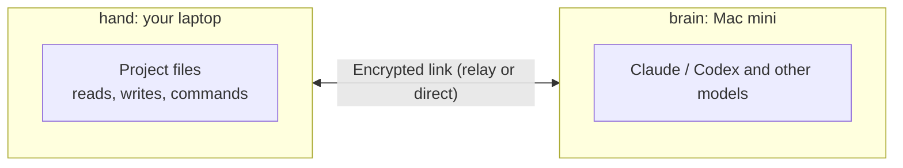

One machine can be both a brain and a hand. **Install the plugin on both machines.**

---

## Before you start (on both machines)

### 1. Install Paseo

Both machines need Paseo **0.16.1 or later**. Download it from <https://paseo.sh> if you don't have it. To check the version, open the Paseo app → **Settings** → **About**.

### 2. Check that git and Node are installed

Paseo uses `git` to download the plugin and `npm` to install its dependencies, so both must be on your computer.

Open the **Terminal** app (press `Cmd + Space`, type "Terminal", press Return), paste this line, and press Return:

```bash
git --version && node --version && npm --version
```

You're set if you see three version numbers and Node is **v20.19.0 or later** (the screenshot shows v24.16.0):

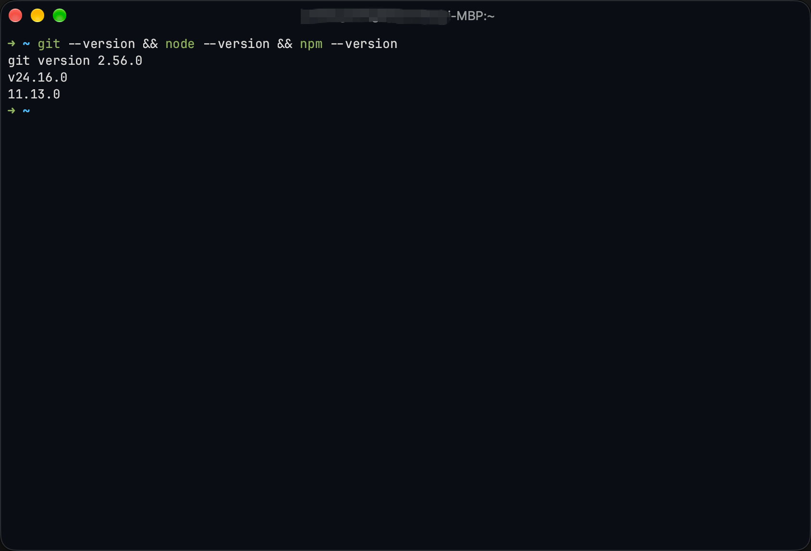

If you see `command not found`:

- **git is missing**: run `xcode-select --install` in Terminal and click **Install** in the dialog.
- **node / npm is missing**: download the LTS installer from <https://nodejs.org> and run it. With Homebrew, you can run `brew install node` instead.

> ⚠️ **After installing Node, fully quit Paseo and reopen it**: press `Cmd + Q` and make sure the Paseo icon is gone from the menu bar at the top of the screen, then open Paseo again. Otherwise Paseo still can't find npm, and installing fails with the error below (see [Troubleshooting](#install-fails-with-spawn-npm-enoent)):

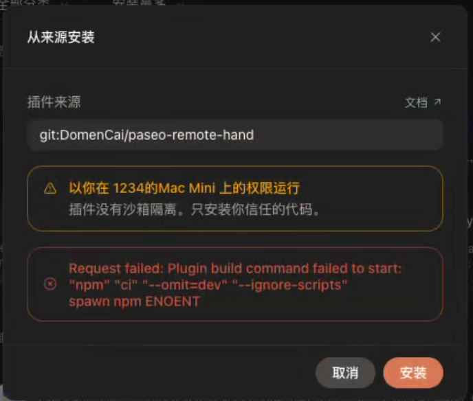

---

## Step 1: Install the plugin (on both machines)

### 1. Open the Plugins page and turn plugins on

Open the Paseo app → **Settings**. In the left sidebar, under **Host**, select this machine, then click **Plugins** at the bottom.

If the top of the page says "Plugins are off on …", click **Turn on**. A fresh Paseo install has plugins turned off.

> The screenshot comes from a machine that already has other plugins installed.

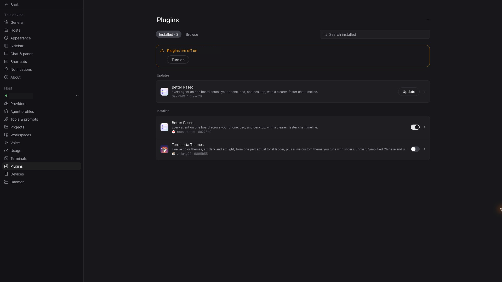

### 2. Find Remote hand in Browse

Remote hand is listed in the official Paseo plugin registry. At the top of the Plugins page, click **Browse**, type `remote hand` in the search box, and find **Remote hand** by **domencai**. Click **Install** on that row.

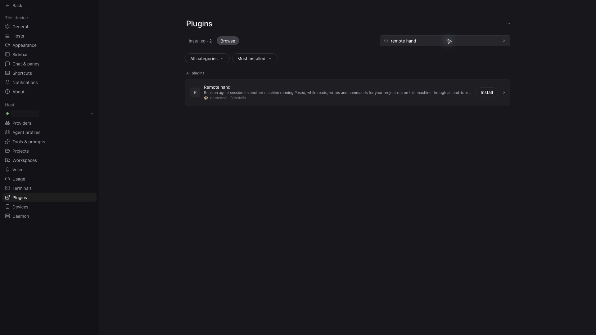

The install dialog shows the **Author**, **Source**, and **Version**. Check that the author is `domencai`. The source is `https://github.com/DomenCai/paseo-remote-hand`, but the dialog may cut it off with "…". The yellow notice "Runs with your access on …" is expected: Paseo plugins are not sandboxed. Click **Install**.

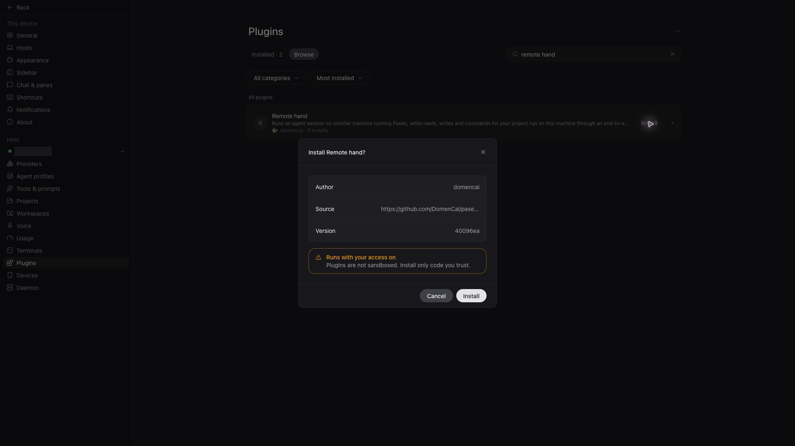

### 3. Wait for the install to finish

Paseo downloads the code from GitHub and then installs its dependencies. This usually takes 10 seconds to a minute. When it's done, **Remote hand** appears in the **Installed** list with its switch on.

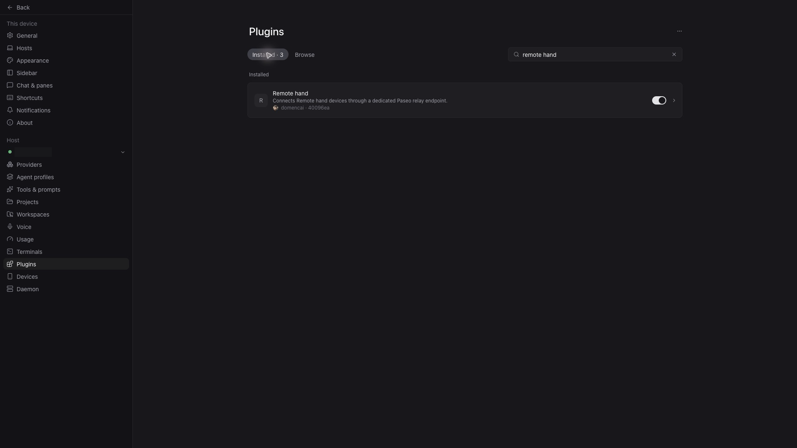

### 4. Open the Remote hand settings

Click the Remote hand row to open its details page. It has two tabs, and everything that follows happens there:

- **Remote machines**: used on the hand, to add other machines and use their models.
- **Connected devices**: used on the brain, to invite other machines to use this machine's models.

**Finish Step 1 on both machines before you continue.**

---

## Step 2: Generate a pairing code on the brain

Do everything in this step on the **brain** (the machine that provides the models).

### 1. Make sure the models work on the brain

The brain can only offer models that **already work** in its Paseo. First test it on the brain itself: open any project in the brain's Paseo, start a new agent with Claude or Codex, send any message, and make sure you get a reply.

### 2. Open Connected devices

Plugins page → Remote hand → **Connected devices** tab. Check that **Status** under **Local endpoint** says **Connected**. If it says "Connecting", wait a few seconds.

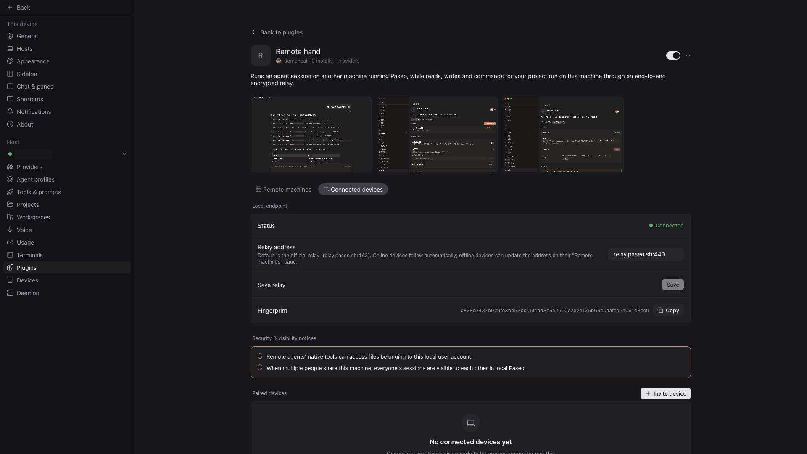

### 3. Invite a device

Scroll down to **Paired devices** and click **Invite device** next to it. While no device is paired, the empty list has an **Invite device** button too. In **Device label (optional)**, you can enter the other computer's name, such as "MacBook Pro", or leave it empty. Click **Generate pairing code**.

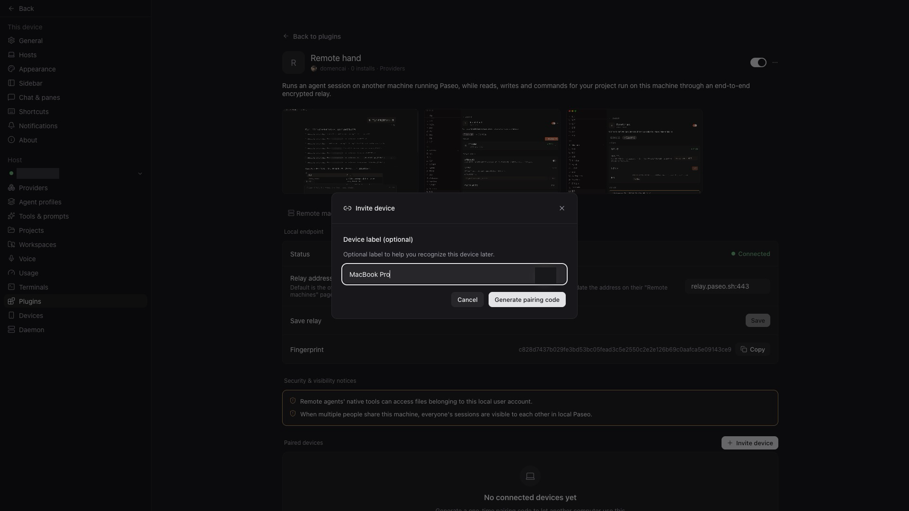

### 4. Copy the pairing code

The dialog shows a code starting with `rh1.`, with the remaining time below it on the right. Click **Copy pairing code**, then **Done**.

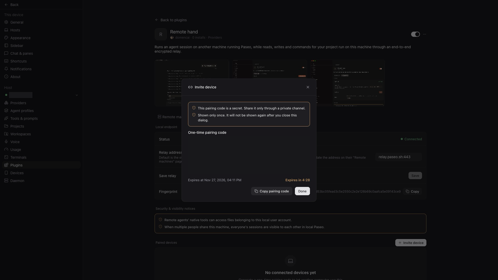

> 🔒 **The pairing code is a secret**:
>
> - It's **valid for 5 minutes** and **works only once**.
> - It isn't shown again after you close the dialog. If it expires, just generate a new one.
> - Send it to your other machine only through a private channel, such as AirDrop or a chat with yourself. Don't post it in a group chat.

### 5. (Optional) Limit which models are offered

On the **Connected devices** tab, scroll down to **Access control**. **Allow all providers** is on by default. To offer only some models, turn it off, check the providers you want to offer, and click **Save** next to **Save access control**.

The same section has two more settings. **Let devices choose permission modes** is off by default, so devices can only use this machine's default mode for each provider. **Max running sessions per device** defaults to 1 on Linux, with a maximum of 2, and to 2 on other systems; idle sessions don't count. The [Step 3 screenshot](#4-connected-means-it-worked) of the brain shows this section.

---

## Step 3: Add the remote machine on the hand

Do everything in this step on the **hand** (the machine you work on), before the pairing code expires.

### 1. Open Remote machines

Plugins page → Remote hand → **Remote machines** tab, then click **Add machine**.

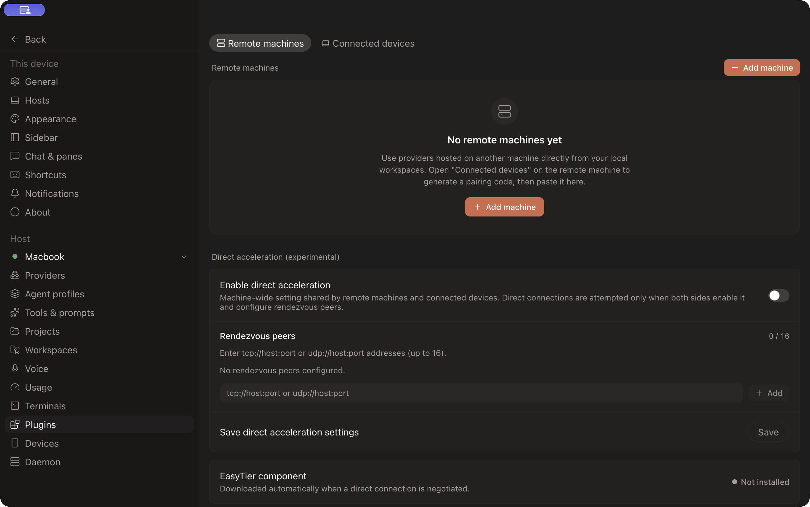

### 2. Paste the pairing code

Paste the pairing code you copied into the box and click **Continue**.

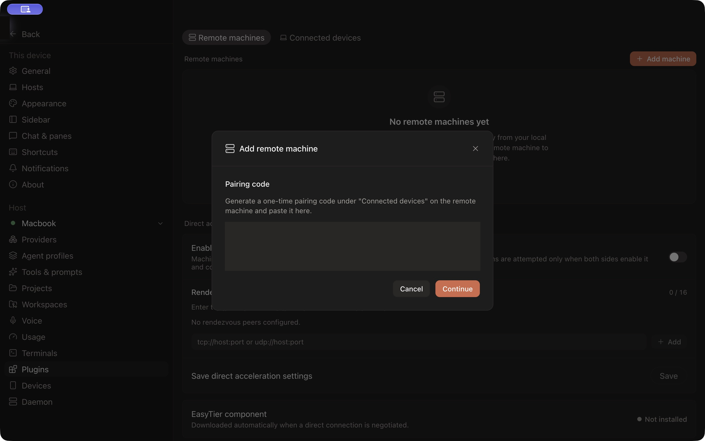

### 3. Check the details and add the machine

The dialog shows **Machine details**: the machine name, system, and relay. Make sure this is your own brain.

**Display name** is the name shown later in the model list. You can change it to something easy to recognize, such as "Mac mini".

If you see "Confirm risks before continuing", read each item and check all of them.

Click **Add remote machine**.

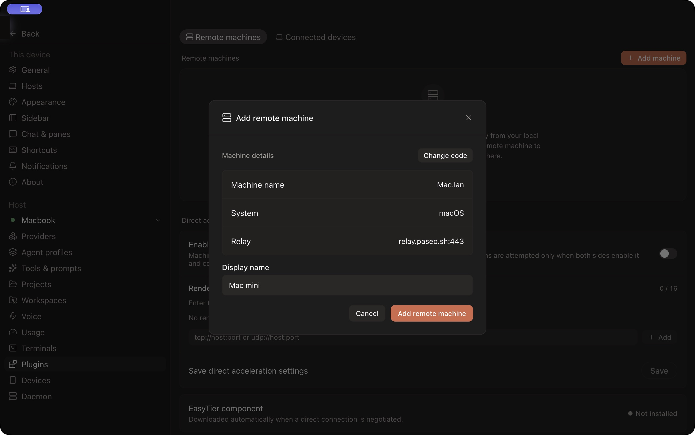

### 4. "Connected" means it worked

The machine appears in the list with the status **Connected**. The line below it shows the system, the permission level, and the transport (relay).

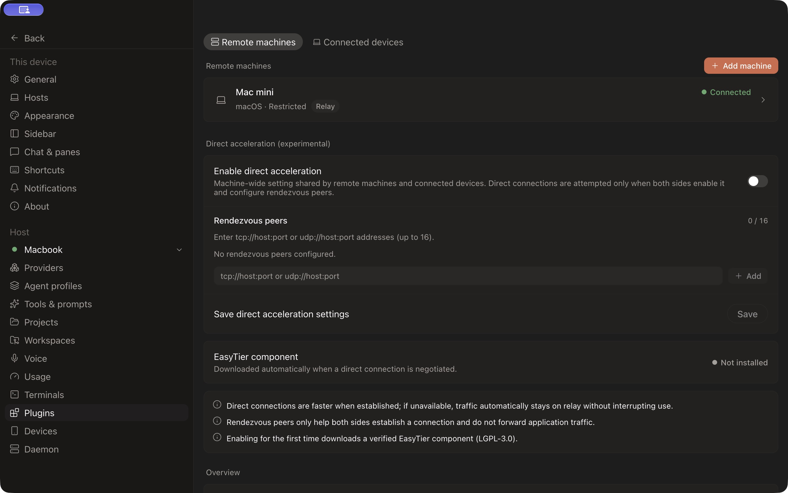

Back on the brain's **Connected devices** tab, the hand also appears under **Paired devices** as "Online", with the number of sessions it is running. **Access control** is below it.

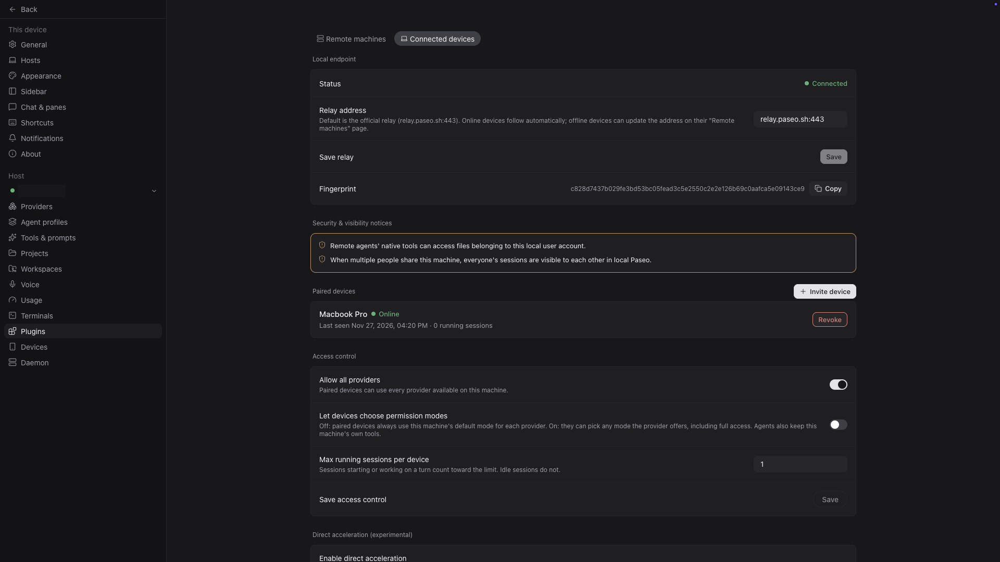

---

## Step 4: Start using it

### 1. Pick a remote model

On the hand, open a project workspace and create a new agent. Click the model button below the input box, find **Remote Hand** in the list, expand it, and pick a model. Model names look like "brain name · provider · model", for example "Mac mini · Claude · Opus 5.5".

Leave the mode next to it at **Use brain default** to use the default mode the brain has for that provider.

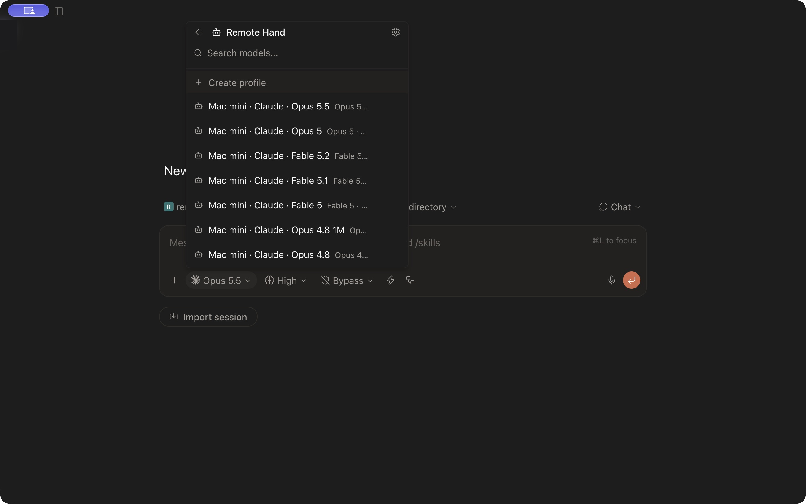

### 2. Try it

Send a message such as:

```
What's in this project?
```

The timeline shows tool calls similar to `remote-hand / hand_read` (the prefix varies a little by provider, but the tool names all start with `hand_`). The paths are **this project on the hand**, which means everything works: the model thinks on the brain, and the files are read on the hand.

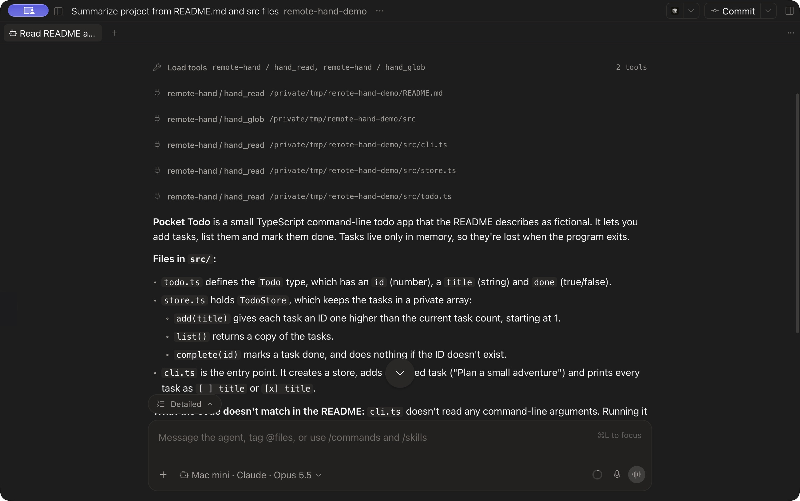

---

## Permissions: Restricted and Full

Each remote machine has a **Permission level**. On the hand, open Plugins page → Remote hand → **Remote machines**, click the machine, and scroll down to **Permissions**.

| Level | What it allows | Good for |
|---|---|---|
| **Restricted** (default) | Reads and writes files only in authorized projects. **Can't run commands** | Reading and editing code |
| **Full** | Reads and writes any file you can access, and **runs any command** on the hand | Running tests, builds, git operations |

Switching to **Full** asks you to confirm once more. Turn it on only for brains you trust.

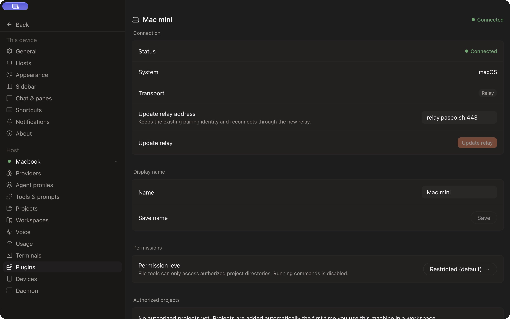

This page also shows:

- **Authorized projects**: a project is added automatically the first time you use this machine in it. You can revoke a project here when you no longer want to authorize it.

  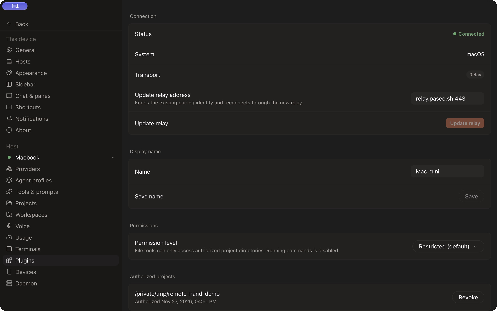

- **Available models**: the models the brain offers you.

To check that **Full** works, start a new session and ask it to run `hostname`. It should return the **hand's** machine name.

---

## Optional: Direct acceleration

By default, traffic between the two machines goes through the official Paseo relay, which works out of the box. For more speed, you can turn on direct connections: once the two machines connect, traffic goes peer to peer. If they can't connect, it falls back to the relay automatically, so nothing breaks.

Direct connections need a **rendezvous node** that helps the two machines find each other. The plugin doesn't provide a public one, so you need to **deploy your own on a Linux server (VPS) with a public IP**. Run this one line on the server; when it finishes, it prints the two addresses to enter:

```bash
curl -fsSL https://raw.githubusercontent.com/DomenCai/paseo-remote-hand/main/deploy/rendezvous.sh | sudo bash
```

Remember to allow port `11010` for both TCP and UDP in your cloud provider's security group. For what the script does, how to uninstall, and manual setup, see [Self-hosting a rendezvous node](direct.md#自建会合节点) (in Chinese). The rendezvous node only helps the two sides connect and doesn't forward your traffic, so the smallest VPS is enough.

Once it's deployed, **do the following on both machines:**

1. Open Plugins page → Remote hand. Below the **Remote machines** or **Connected devices** tab, find **Direct acceleration (experimental)** (see the [Step 3 screenshot](#1-open-remote-machines) for where it is).
2. Turn on **Enable direct acceleration**.
3. In the rendezvous peer field, enter `udp://your-server-address:11010` and `tcp://your-server-address:11010` one at a time, clicking **Add** after each.
4. Click **Save** next to **Save direct acceleration settings**.

After both sides save their settings and start negotiating a direct connection, the first time it automatically downloads an EasyTier component of about 30 MB. The **EasyTier component** row shows the download progress and changes to **Ready** when done. After about a minute, the **Transport** of this remote machine on the hand changes from relay to **Direct**.

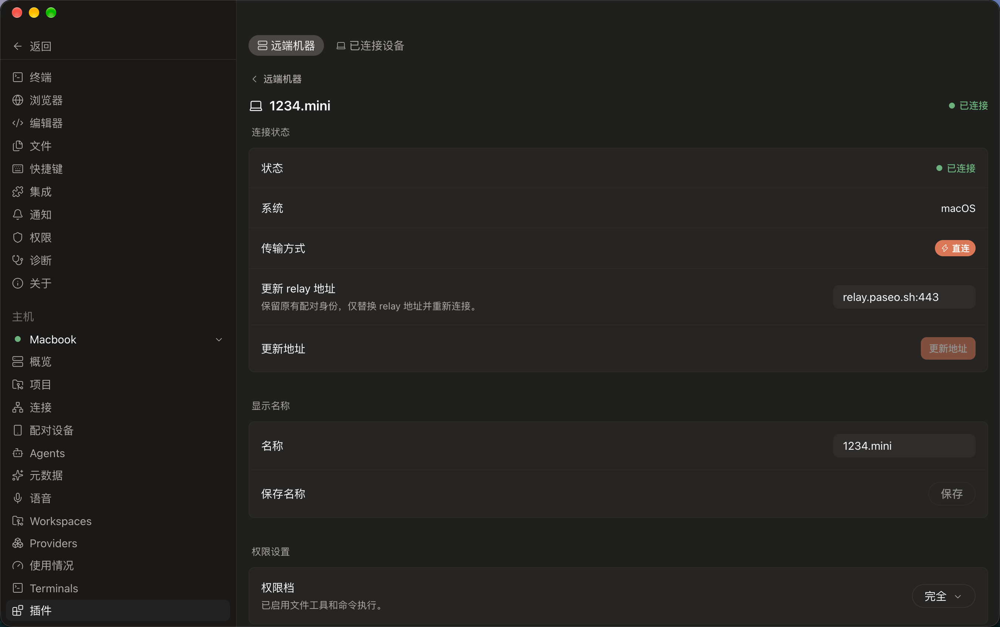

If the download is slow or fails, follow the hint on the page: download the ZIP from the official link, paste its file path, and click **Import**. For technical details, see [EasyTier direct connection](direct.md) (in Chinese).

---

## Troubleshooting

### Install fails with `spawn npm ENOENT`

Paseo can't find npm. To fix it:

1. Follow [Before you start](#2-check-that-git-and-node-are-installed) and make sure `npm --version` works in Terminal. If it doesn't, install Node first.
2. **Fully quit Paseo (`Cmd + Q`) and reopen it**, then install again.
3. If Node was installed with nvm, fnm, mise, or a similar tool, Paseo sometimes still can't find it. Download the official installer from <https://nodejs.org>, install Node again, then fully quit and reopen Paseo as in item 2.

`spawn git ENOENT` works the same way: install git as described in Before you start.

### The install hangs or fails with a network error

Installing needs access to GitHub and npm. On a poor connection, turn on a proxy and try again.

### The pairing code is rejected when adding the remote machine

The pairing code has expired (more than 5 minutes) or was already used. Go back to the brain and generate a new one with **Invite device**.

### The remote machine stays "Disconnected" or "Connecting"

- Make sure the brain is on and Paseo is running on it.
- Click the machine and check **Last error** for the specific reason.
- If the brain changed its relay address, follow the hint on the page and paste the new address into **Update relay address**. You don't need to pair again.

### Remote Hand or the remote models are missing from the model list

- Make sure the remote machine shows "Connected".
- On the brain, check **Connected devices** → **Access control** to see whether the provider you want is offered.
- Make sure the model works in the brain's own Paseo.

### Still stuck?

Run this command in Terminal and send the output to the maintainer:

```bash
paseo plugin logs remote-hand
```

---

## Uninstall

1. On the hand: Plugins page → Remote hand → **Remote machines** → click the machine → **Remove machine** at the bottom → **Remove**. This also revokes this machine's access on the brain.
2. On each machine, uninstall it from the **···** menu at the top right of the Remote hand details page, or run this in Terminal:

   ```bash
   paseo plugin remove remote-hand
   ```

The plugin's device identity stays on the machine, so you don't need to create a new identity if you reinstall.
