# Remote hand 安装教程

这篇教程一步一步带你装好 Remote hand，大约需要 10 分钟。截图和操作以 macOS 为例。想让 coding agent 代装，把 [agent 安装手册](install-agent.md) 发给它即可。English: [install-guide.en.md](install-guide.en.md).

## Remote hand 能做什么

在 A 电脑上写代码，却想用 B 电脑上的模型：比如 B 是一台常开的 Mac mini，登录了 Claude、Codex 订阅。装好 Remote hand 后：

- 在 A 的 Paseo 里新建 agent，模型选「B · Codex · GPT-…」。
- 对话跑在 B 上，用的是 B 的订阅。
- 读文件、改文件、运行命令都发生在 A 的项目里。

教程里的两个称呼：

| 称呼 | 是哪台机器 | 例子 |
|---|---|---|
| **brain** | 提供模型的机器 | 常开的 Mac mini |
| **hand** | 放项目、你在上面干活的机器 | 你的笔记本 |

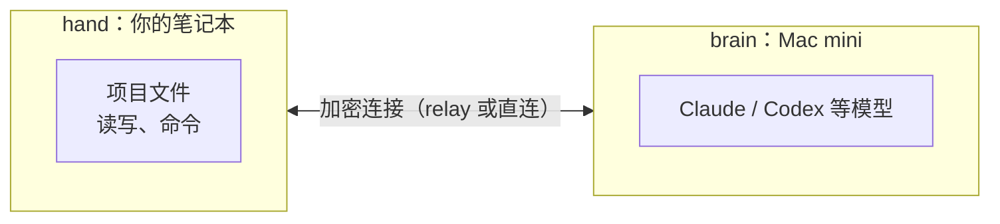

一台机器可以同时当 brain 和 hand。**两台机器都要安装插件。**

---

## 准备工作（两台机器都要做）

### 1. 安装 Paseo

两台机器都需要 Paseo **0.16.1 或更新版本**，没装的话到 <https://paseo.sh> 下载。查看版本：打开 Paseo App →「设置」→ 主机下的本机 →「概览」。

### 2. 确认电脑上有 git 和 Node

Paseo 安装插件时要用 `git` 下载代码、用 `npm` 安装依赖，所以电脑上必须有这两样。

打开「终端」App（按 `Cmd + 空格`，输入"终端"后回车），粘贴下面这行并回车：

```bash
git --version && node --version && npm --version
```

看到三行版本号，并且 Node 是 **v20.19.0 或更新**（截图里是 v24.16.0）就没问题：

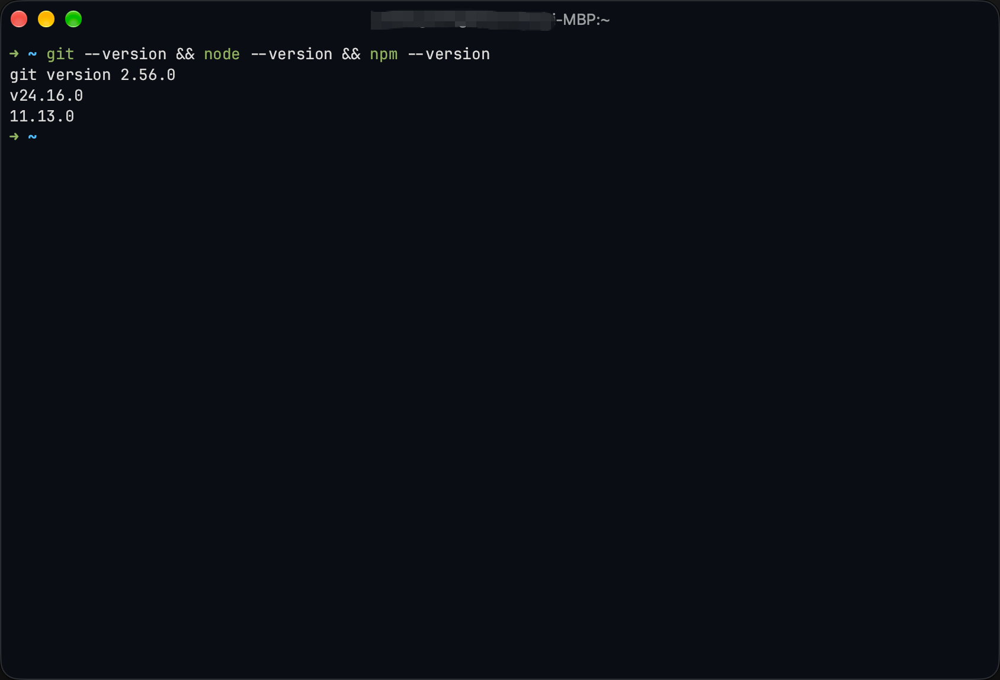

如果报 `command not found`：

- **缺 git**：在终端运行 `xcode-select --install`，在弹窗里点「安装」。
- **缺 node / npm**：到 <https://nodejs.org> 下载 LTS 版安装包，双击安装；装了 Homebrew 的话也可以运行 `brew install node`。

> ⚠️ **刚装完 Node，一定要彻底退出 Paseo 再打开**：按 `Cmd + Q`，确认屏幕顶部菜单栏里的 Paseo 图标也消失了，再重新打开。否则 Paseo 还找不到 npm，安装时会报下面这个错（见[常见问题](#安装时报-spawn-npm-enoent)）：

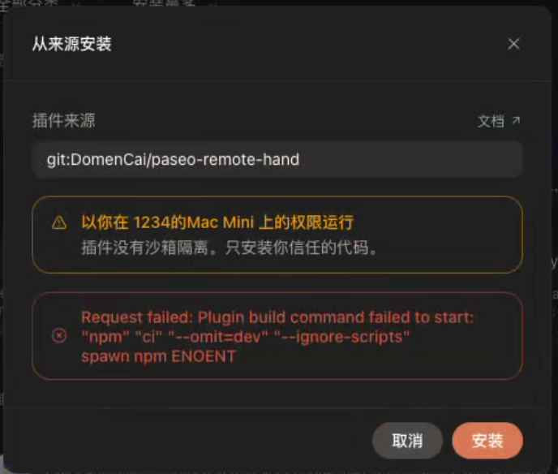

---

## 第一步：安装插件（两台机器都要做）

### 1. 打开插件页并开启插件功能

打开 Paseo App →「设置」，在左侧「主机」下找到本机（图里是 Macbook），点最下面的「插件」。

新装的 Paseo 默认关闭插件，页面顶部会显示「xxx 上的插件已关闭」。点「开启」。

> 截图来自已经装过插件的机器。第一次安装时，下方「已安装」列表里没有 Remote hand。

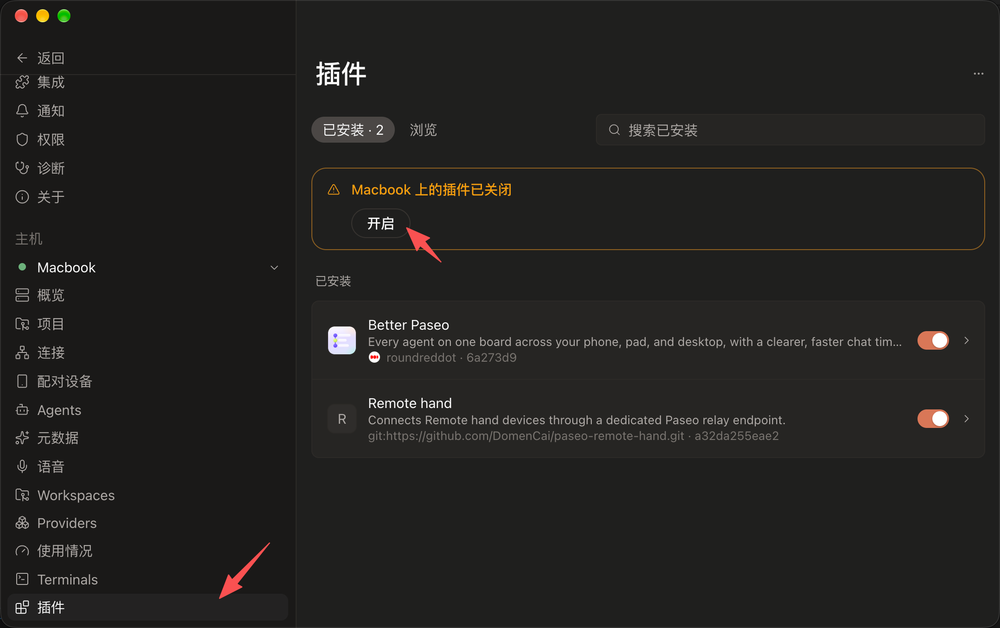

> 跳过这一步也行：通过「从来源安装」装插件时，Paseo 会顺便开启插件功能。

### 2. 从来源安装

点插件页右上角的「···」，选「从来源安装」。

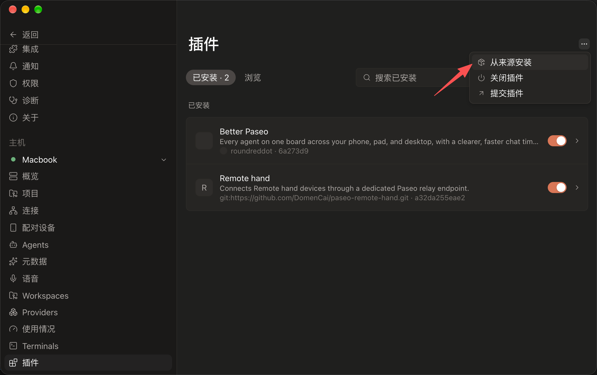

在「插件来源」输入框里**原样**粘贴：

```
git:DomenCai/paseo-remote-hand
```

弹窗里的黄色提示「以你在 xxx 上的权限运行」是正常的：Paseo 的插件都没有沙箱隔离。确认来源无误后点「安装」。

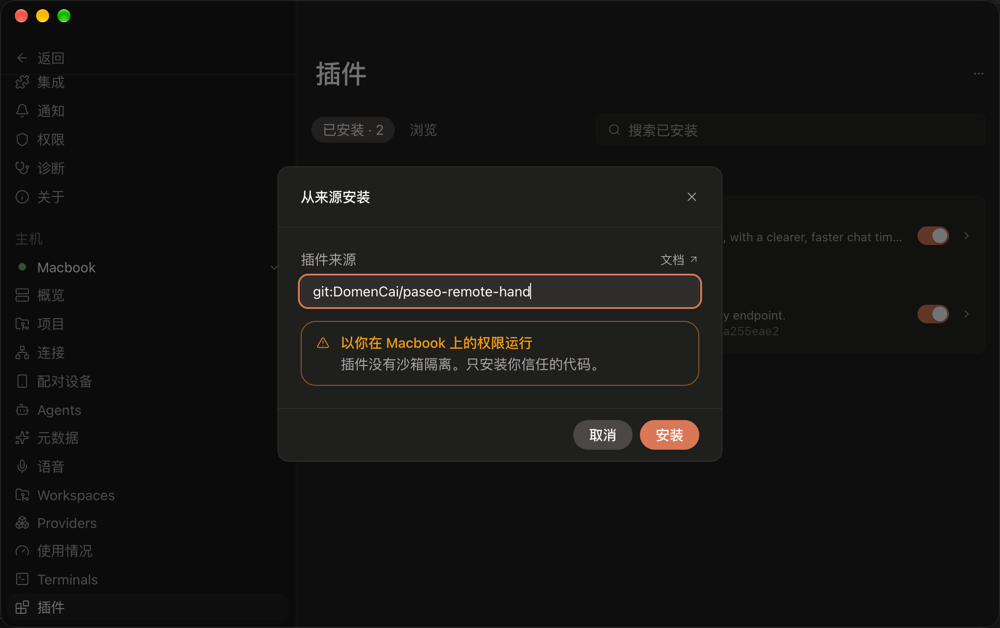

### 3. 等待安装完成

Paseo 会先从 GitHub 下载代码，再安装依赖，通常需要 10 秒到 1 分钟。完成后，「已安装」列表里会出现 **Remote hand**，右边的开关是打开的。

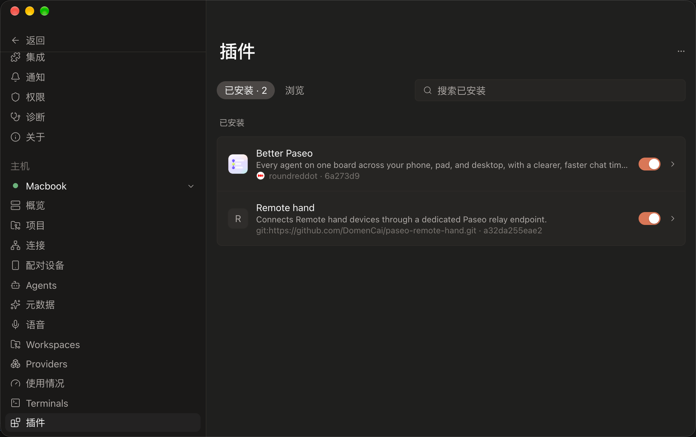

### 4. 打开 Remote hand 的设置

点 Remote hand 这一行，进入插件详情页。上方有两个标签页，后面都在这里操作：

- **远端机器**：hand 用，添加别的机器来用它们的模型。
- **已连接设备**：brain 用，邀请别的机器来用本机的模型。

**两台机器都完成第一步后，再往下做。**

---

## 第二步：在 brain 上生成配对码

以下操作都在 **brain**（提供模型的机器）上做。

### 1. 确认模型在 brain 上能用

brain 只能把 Paseo 里**已经能用**的模型提供出去。先在 brain 的 Paseo 里用 Claude 或 Codex 新建一个普通 agent，随便聊一句，确认有回复。

### 2. 打开「已连接设备」

插件页 → Remote hand → 切到「已连接设备」标签。确认「本机端点」里的「端点状态」是 **已连接**；如果是「连接中」，等几秒。

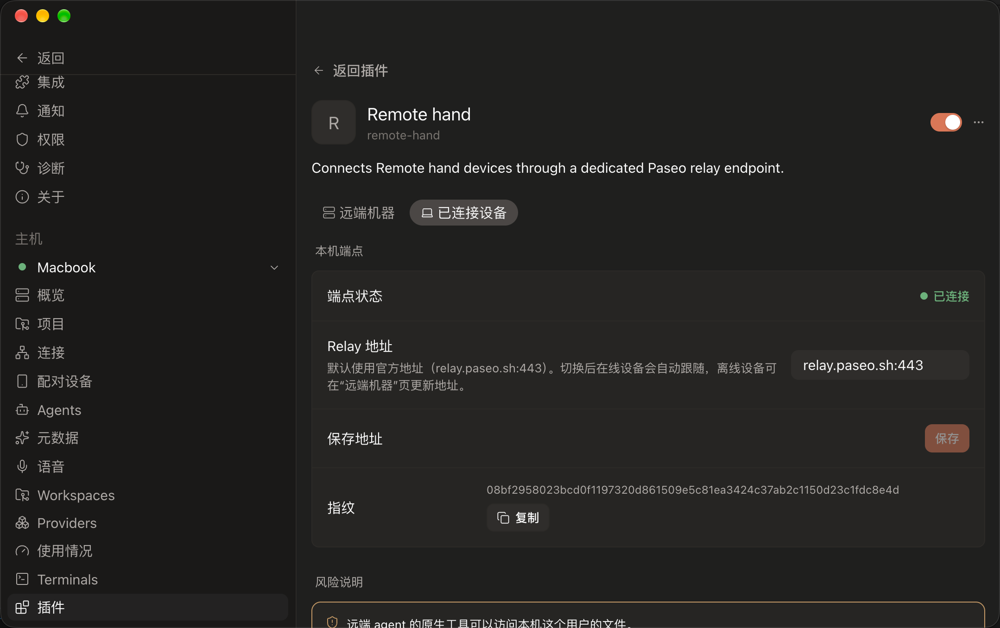

### 3. 邀请设备

往下滚，点「邀请设备」。「设备备注」可以填对方电脑的名字，比如"工作电脑"，也可以留空。点「生成配对码」。

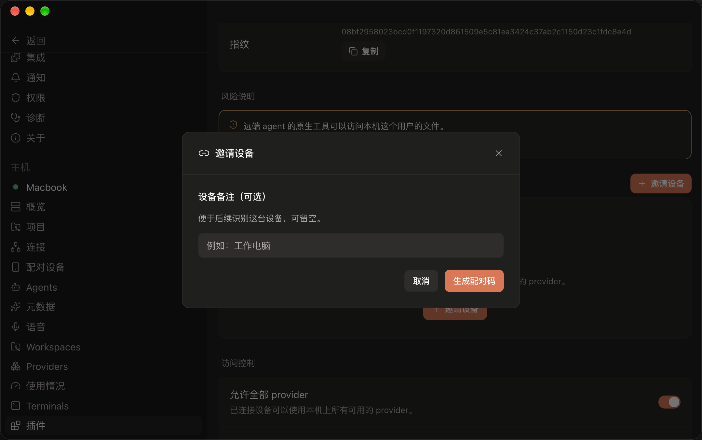

### 4. 复制配对码

弹窗里会显示一串以 `rh1.` 开头的配对码，配对码下方右侧是剩余时间。点「复制配对码」，再点「完成」。

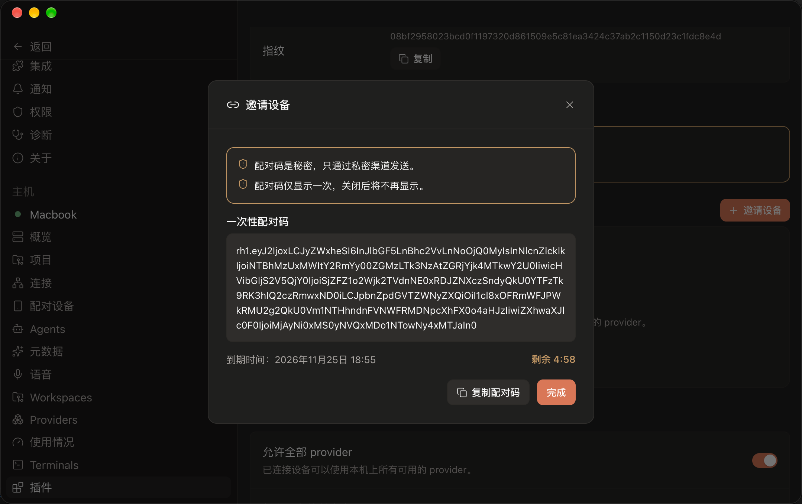

> 🔒 **配对码是秘密**：
>
> - **5 分钟内有效**，**只能用一次**。
> - 关掉弹窗后不会再显示，过期了重新生成就行。
> - 只通过私密渠道发给自己的另一台机器，例如 AirDrop、自己和自己的聊天窗口。不要发到群里。

### 5.（可选）限制开放哪些模型

在「已连接设备」标签往下滚，找到「访问控制」，默认开启「允许全部 provider」。只想开放部分模型时，关掉它，勾选要开放的 provider，再点「保存访问控制」右侧的「保存」。

同一区块还有两项：「允许设备选择权限模式」默认关闭，设备只能用本机为各 provider 设置的默认模式；「每台设备同时运行的会话上限」默认 1，空闲会话不计入。

---

## 第三步：在 hand 上添加远端机器

以下操作都在 **hand**（你干活的机器）上做，要在配对码过期前完成。

### 1. 打开「远端机器」

插件页 → Remote hand → 「远端机器」标签，点「添加远端机器」。

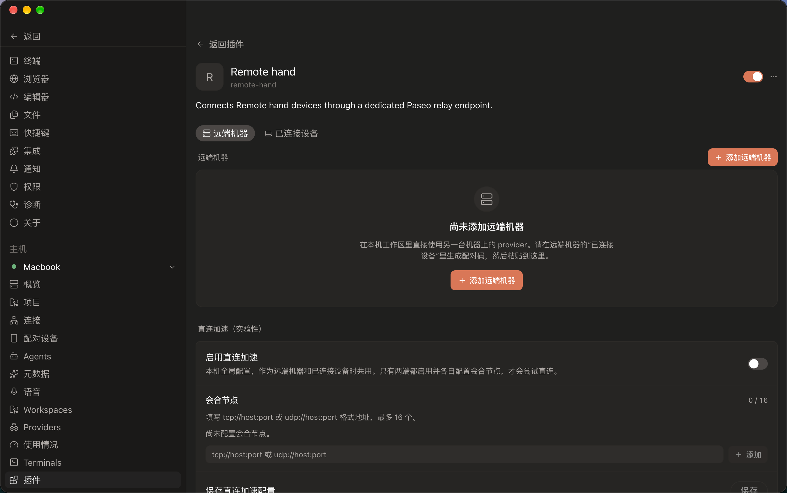

### 2. 粘贴配对码

把刚才复制的配对码粘贴到输入框里，点「下一步」。

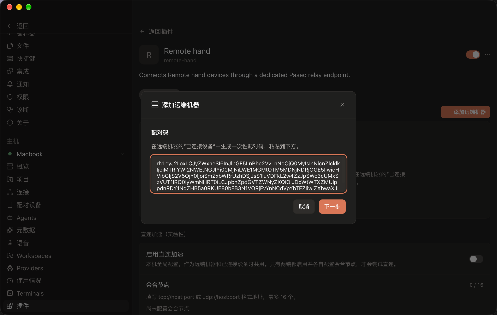

### 3. 核对信息并添加

弹窗会显示「远端机器信息」：机器名称、系统、中继地址。确认是你自己的 brain。

「显示名称」是之后模型列表里显示的名字，可以改成好认的名字，比如"Mac mini"。

如果出现「请逐条确认以下风险后再继续」，逐条读完后全部勾选。

点「添加远端机器」。

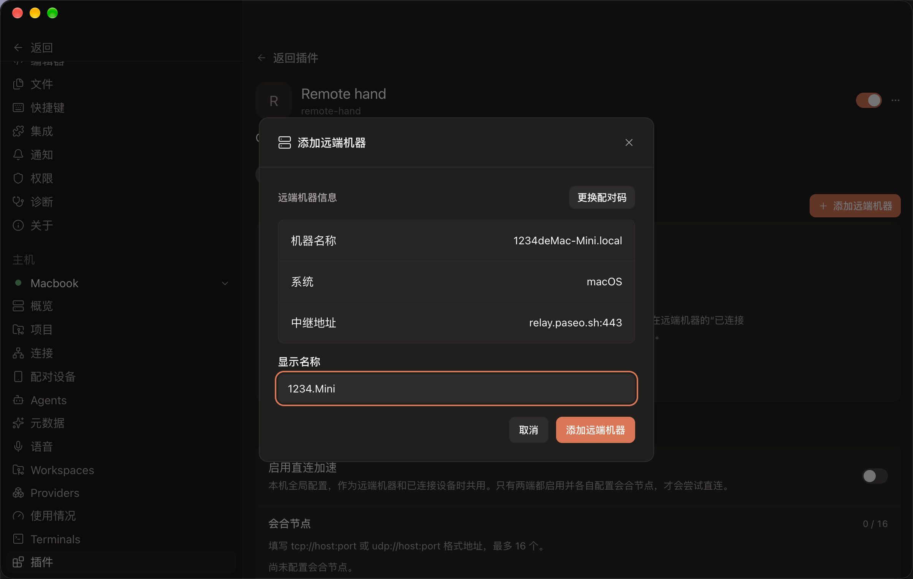

### 4. 看到「已连接」就成功了

列表里出现这台机器，状态是 **已连接**，下面一行写着系统、权限档和传输方式（relay）。

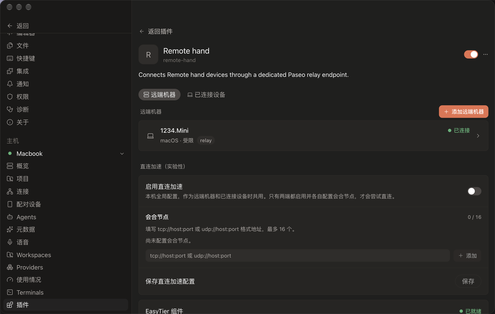

回到 brain 的「已连接设备」标签，也能在设备列表里看到 hand，状态是「在线」。

---

## 第四步：开始使用

### 1. 选择远端模型

在 hand 上打开一个项目 workspace，新建 agent。点输入框下方的模型按钮，在列表里找到 **Remote Hand**，展开后选一个模型。模型名的格式是「brain 名 · provider · 模型」，例如「1234.Mini · Codex · GPT-6.2-Sol」。

旁边的模式保持「Use brain default」即可，使用 brain 为该 provider 设置的默认模式。

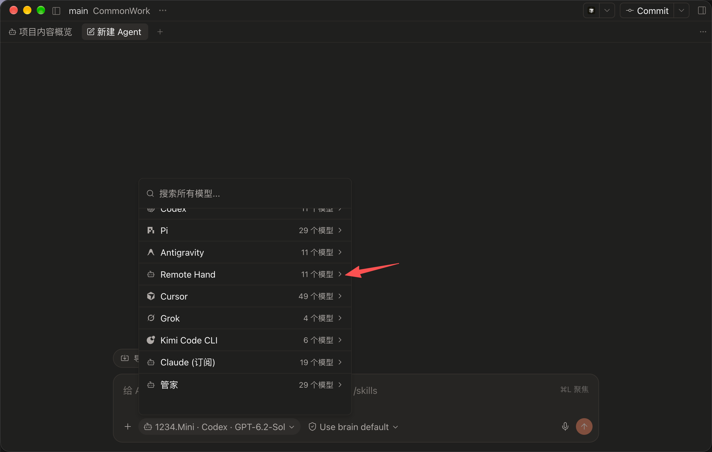

### 2. 试一下

发一句：

```
看一下这个项目里面有什么东西
```

时间线里会出现类似 `remote-hand / hand_read` 的工具调用（前缀随所选 provider 略有不同，工具名都以 `hand_` 开头），路径是 **hand 上这个项目**的路径，说明一切正常：模型在 brain 上思考，文件在 hand 上读。

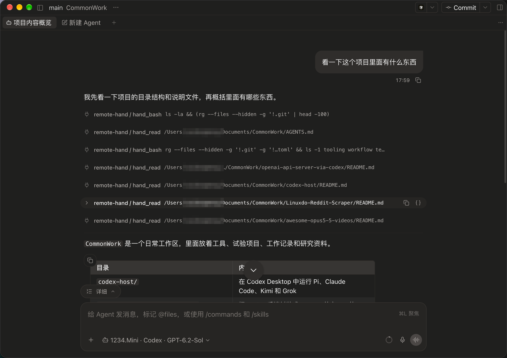

> 截图里还有 `hand_bash`（在 hand 上运行命令），这需要把权限档切到「完全」，见下一节。默认的「受限」档会拒绝运行命令。

---

## 权限：受限和完全

每台远端机器都有一个「权限档」。在 hand 上打开 插件页 → Remote hand →「远端机器」，点进这台机器，往下滚到「权限设置」。

| 权限档 | 能做什么 | 适合 |
|---|---|---|
| **受限**（默认） | 只能读写已授权项目的文件，**不能执行命令** | 看代码、改代码 |
| **完全** | 可以读写你能访问的所有文件，也能在 hand 上**运行任意命令** | 需要跑测试、构建、git 操作 |

切到「完全」时会弹窗再确认一次。只对你信任的 brain 开启。

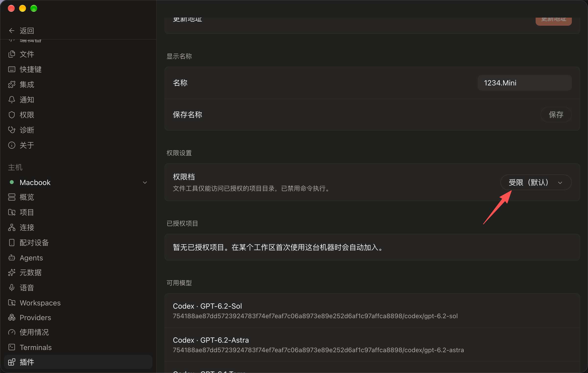

这个页面还能看到：

- **已授权项目**：在某个项目里第一次用这台机器时，会自动加入列表；不想再授权时可以在这里撤销。
- **可用模型**：brain 开放给你的模型。

验证「完全」档是否生效：新建一个会话，让它运行 `hostname`。返回的应该是 **hand** 的机器名。

---

## 可选：直连加速

默认情况下，两台机器之间的数据经 Paseo 官方 relay 中转，开箱即用。如果想更快，可以开启直连：两台机器打通后点对点传输，打不通时自动回到 relay，不影响使用。

直连需要一个**会合节点**，帮两台机器互相找到对方。插件不提供公共会合节点，需要你**在一台有公网 IP 的 Linux 服务器（VPS）上自己部署**。在服务器上运行这一行即可，脚本跑完会打印要填的两个地址：

```bash
curl -fsSL https://raw.githubusercontent.com/DomenCai/paseo-remote-hand/main/deploy/rendezvous.sh | sudo bash
```

记得在云厂商的安全组里放行 `11010` 端口的 TCP 和 UDP。脚本做了什么、怎么卸载、怎么手动部署，见 [自建会合节点](direct.md#自建会合节点)。会合节点只帮两端建立连接，不转发业务数据，配置很低的 VPS 就够用。

部署好之后，**两台机器都要做：**

1. 打开 插件页 → Remote hand，在「远端机器」或「已连接设备」标签下方找到「直连加速（实验性）」（位置见[第三步的截图](#1-打开远端机器)）。
2. 打开「启用直连加速」。
3. 在会合节点输入框里分别填入 `udp://你的服务器地址:11010` 和 `tcp://你的服务器地址:11010`，每填一个点一次「添加」。
4. 点「保存直连加速配置」右侧的「保存」。

两端都保存好配置后开始协商直连，首次会自动下载一个约 30 MB 的 EasyTier 组件，「EasyTier 组件」一栏会显示下载进度，完成后变成「已就绪」。大约 1 分钟后，hand 上这台远端机器的「传输方式」会从 relay 变成 **直连**。

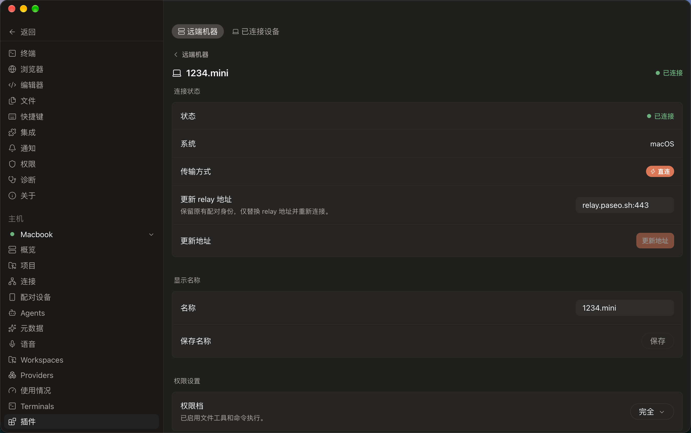

如果下载很慢或失败，按页面上的提示，从官方链接手动下载 ZIP，再把文件路径粘贴进去点「导入」。技术细节见 [EasyTier 直连](direct.md)。

---

## 常见问题

### 安装时报 `spawn npm ENOENT`

Paseo 找不到 npm。处理方法：

1. 按[准备工作](#2-确认电脑上有-git-和-node)确认终端里能运行 `npm --version`；不能就先安装 Node。
2. **彻底退出 Paseo（`Cmd + Q`）再打开**，然后重新安装。
3. 如果 Node 是用 nvm、fnm、mise 之类的工具安装的，Paseo 有时仍然找不到。到 <https://nodejs.org> 下载官方安装包再装一份，然后按第 2 条再彻底退出并重新打开 Paseo。

`spawn git ENOENT` 同理，按准备工作安装 git。

### 安装时卡很久或报网络错误

安装要访问 GitHub 和 npm。网络不好时，开启代理后重试。

### 添加远端机器时提示配对码无效

配对码已经过期（超过 5 分钟）或者已经用过。回到 brain 重新「邀请设备」生成一个。

### 远端机器一直显示「断开」或「连接中」

- 确认 brain 开着机，Paseo 也在运行。
- 点进这台机器，看「最近错误」里的具体原因。
- 如果 brain 更换过 relay 地址，按页面提示在「更新 relay 地址」里粘贴新地址，不需要重新配对。

### 模型列表里没有 Remote Hand 或没有远端模型

- 确认远端机器是「已连接」。
- 到 brain 的「已连接设备」→「访问控制」，看看要用的 provider 是否已开放。
- 确认这个模型在 brain 本机的 Paseo 里能正常使用。

### 还是解决不了

在终端运行下面的命令，把输出发给维护者：

```bash
paseo plugin logs remote-hand
```

---

## 卸载

1. 在 hand 上：插件页 → Remote hand →「远端机器」→ 点进机器 → 页面底部「移除机器」→「移除」。这样也会撤销本机在 brain 上的访问权限。
2. 两台机器分别在插件页的 Remote hand 详情页右上角「···」里卸载，或者在终端运行：

   ```bash
   paseo plugin remove remote-hand
   ```

插件的设备身份会保留在本机，重新安装后不需要重新生成身份。
